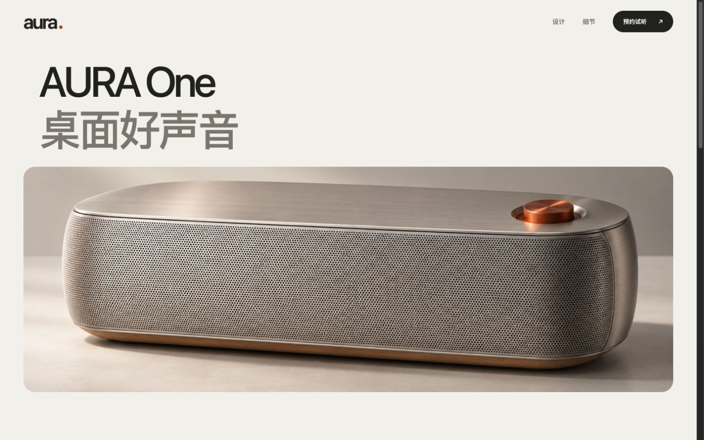
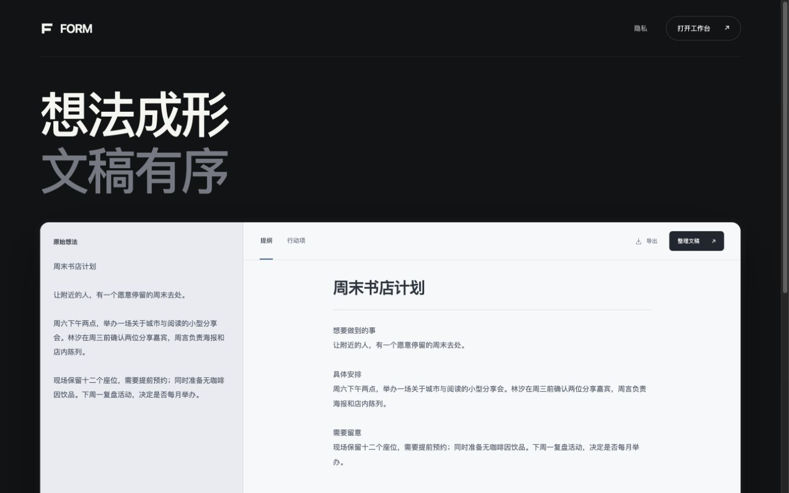
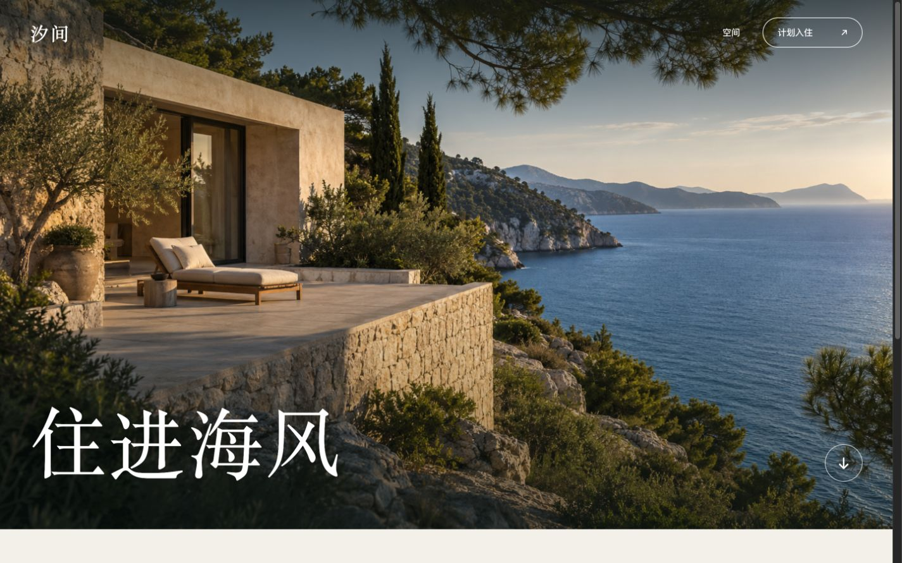
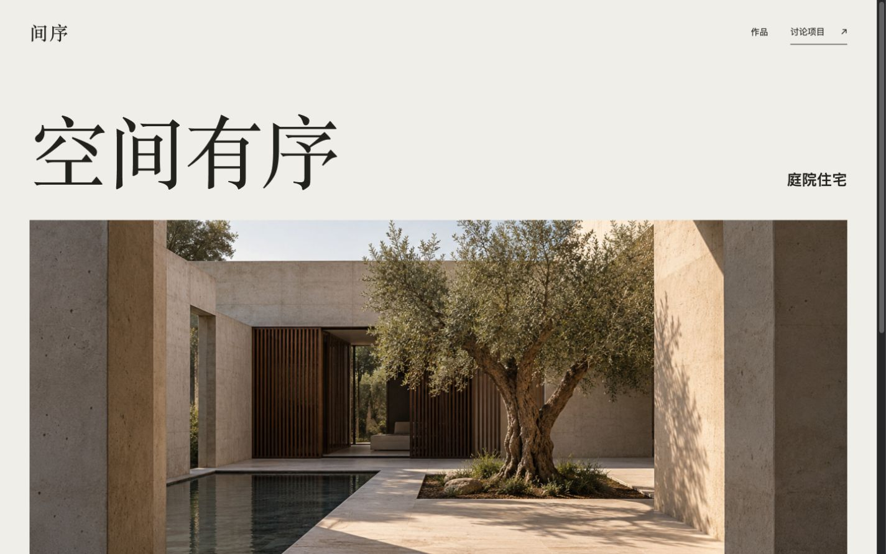
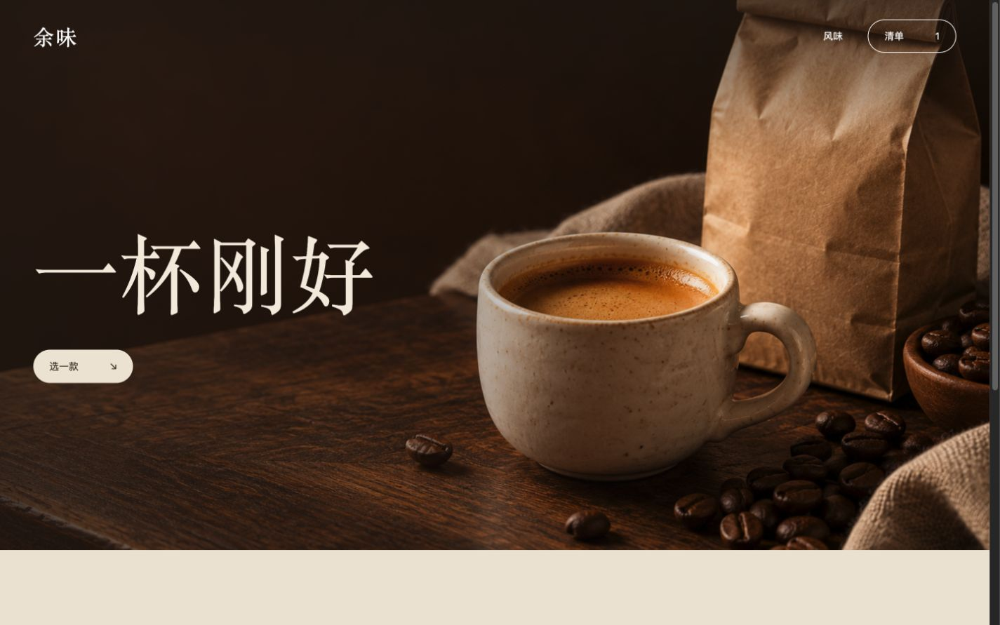

# Less but better

先做减法 再把留下的内容做好

一个同时处理系统架构与界面的精简 skill，配有五个可运行行业页面、故障恢复案例和可复现的架构对照

## 核心方法

- 先保住完整任务与必要保证，再比较更小的承接路径
- 追到规则和状态的拥有者，验证作用域、有效期与副作用边界
- 整页辅助文案默认最多两块，不按每屏重置
- 用准确词组和主体表达产品，标题与卖点尽量无装饰性标点
- 共用网格、边界与基线，统一文字角色和间距关系
- 用真实影像或可操作界面承担主视觉
- 桌面与手机重新编排，检查真实内容、状态与关键流程

[Skill 入口](SKILL.md) · [架构减法](references/system-simplification.md) · [界面设计](references/interface-design.md) · [综合取舍](references/synthesis.md)

## 架构验证

[接受回执与副作用恢复](evals/architecture-lab/README.md)比较原分层、完整精简与不安全替代，在明确模拟协议下检查中断恢复。持久化意图不等于远端副作用只发生一次；缺少恢复协议时保留不确定状态

运行 `python3 -B evals/architecture-lab/probe.py`。这是作者候选回归，不是 Agent 对照或生产保证；范围与结果见 [本地整合验证](evidence/consolidation.json)

[印刷报价系统对照](evals/print-studio/README.md)：普通 Agent 与使用 skill 的 Agent 都通过同一组 18 项契约测试，并得到相同的主要架构精简结果。本案例未显示 skill 的额外架构优势，完整候选源码与验收可复现

[独立发布审查](evidence/independent-review.md)已通过，结论限报告列出的本地内容与验证范围

## 五个行业案例

| 场景 | 设计重点 | 实际交互 | 源码 |
| --- | --- | --- | --- |
| AURA 音响 | 产品尺度 材质细节 | 本地试听计划 | [查看](examples/audio/) |
| FORM 软件 | 文稿层级 精简工具 | 整理 取消 编辑 导出 | [查看](examples/software/) |
| 汐间 旅居 | 全幅影像 空间氛围 | 日期校验 保存入住计划 | [查看](examples/hotel/) |
| 间序 建筑 | 编辑式网格 留白比例 | 图片放大 保存项目意向 | [查看](examples/architecture/) |
| 余味 咖啡 | 产品构图 色彩与触感 | 风味选择 清单 移除与撤销 | [查看](examples/coffee/) |

### 音响



### 软件



### 旅居



### 建筑



### 咖啡



[手机截图](screenshots/) · [案例验证记录](evidence/verification.json) · [素材来源与提示词](ASSETS.md)

## 使用 skill

让支持读取 Markdown 指令的 Agent 读取 `SKILL.md`，再提供任务目标、必要功能和相关项目材料

```text
读取 SKILL.md 并按它精简这个产品
按任务加载架构或界面方法
先确认必要结果 再减少结构与表达
架构验证承接与失败路径 界面检查真实页面与关键操作
```

不同 Agent 的安装与启用方式不同，这份源码不修改全局配置，也不依赖指定模型

## 本地运行案例

在仓库根目录运行

```sh
python3 -m http.server 8000 --bind 127.0.0.1
```

打开 `http://127.0.0.1:8000/examples/hotel/`，或替换为 `audio`、`software`、`architecture`、`coffee`

案例使用原生 HTML、CSS 和 JavaScript，无前端构建步骤。GitHub 文件页面展示源码，运行页面需使用本地 HTTP 服务

文稿整理的内容保留回归检查可运行 `node --test tests/writing.test.mjs`

## 范围

五个品牌与场景均为概念演示，素材为本次生成的原创图。交互仅使用本机数据，不提交真实预订、咨询、订单或付款；FORM 使用本地规则，不连接在线模型

截图与功能检查不等于用户审美验收，也不能证明对所有 Agent 都有增益

## 许可

[MIT](LICENSE)
